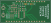
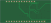
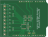
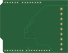
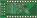
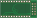

# Arduino MCP3x6x Library

Arduino library for Microchip MCP346xR / MCP356xR 16/24-bit SAR analog-to-digital converters over SPI.

## Supported devices

- MCP3461R / MCP3462R / MCP3464R (16-bit)
- MCP3561R / MCP3562R / MCP3564R (24-bit)

## Installation

Use the Arduino Library Manager and search for **MCP3x6xR**, or clone this repository into your `libraries` folder:

```sh
git clone https://github.com/nerdyscout/Arduino_MCP3x6x_Library.git \
  ~/Arduino/libraries/MCP3x6xR
```

## Quick example

```cpp
#include "Arduino_MCP3x6x_Library.hpp"

MCP3461 mcp;

void setup() {
  Serial.begin(115200);
  mcp.begin();
}

void loop() {
  int32_t raw  = mcp.analogRead(MCP3x6x_CH0);
  double volt  = raw * mcp.getReference() / mcp.getMaxValue();
  Serial.println(volt, 6);
  delay(1000);
}
```

More examples are in the `examples/` folder covering single-ended, differential, scan, and streaming modes.

## Breakout PCBs

Breakout PCBs for this project live in the `pcb/` folder, with KiCad sources for Adafruit, Arduino, and Sparkfun-style boards.

| Board | Top | Bottom |
| --- | --- | --- |
| Adafruit Feather |  |  |
| Arduino Uno |  |  |
| Sparkfun ProMicro |  |  |

## Documentation

Full API reference is generated with Doxygen and hosted at:

https://nerdyscout.github.io/Arduino_MCP3x6x_Library/

Build locally with `doxygen Doxyfile`.

## License

MIT — see `LICENSES/`.
